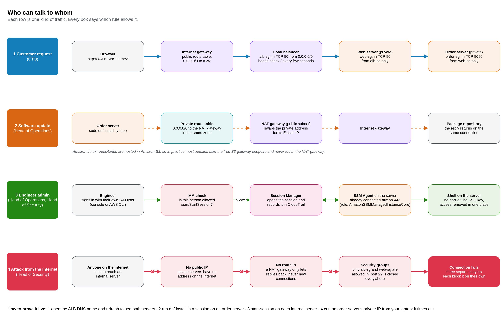
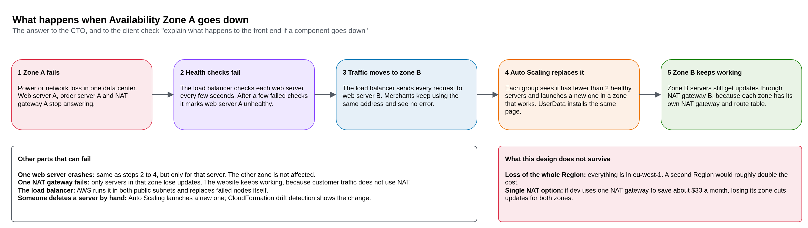
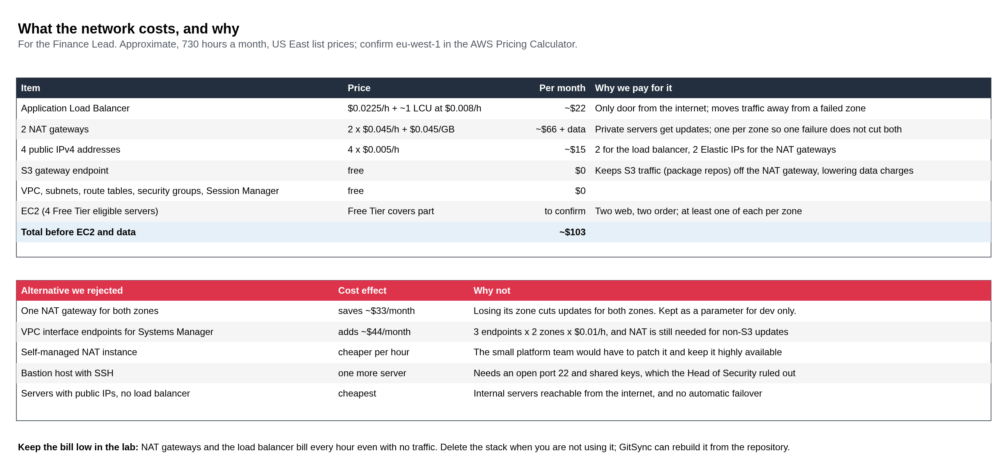

# Onward Logistics: Secure Network for the Order System

Week 2 lab: a highly available, secure network for the Onward Logistics order system, provisioned with AWS CloudFormation and deployed through CloudFormation GitSync.

**Module:** Network & Security on AWS · **Week:** 2 · **Status:** Template drafted, not yet deployed

Full brief: [docs/lab-brief.md](docs/lab-brief.md)

## Client objectives

| # | Objective | Asked by |
|---|-----------|----------|
| 1 | Front end reachable from the internet, and still working if one Availability Zone is lost | Chief Technology Officer |
| 2 | Internal order services unreachable from the internet, but able to download updates | Head of Security, Head of Operations |
| 3 | Engineers administer every server with no open admin ports and no shared keys | Head of Security, Head of Operations |
| 4 | Show what the network costs, and justify the choices on cost and resilience | Finance Lead |
| 5 | Prove every objective to the Head of Security and the Finance Lead | All |

## Mandatory requirements

- Everything provisioned with AWS CloudFormation; nothing created in the console
- Deployed with CloudFormation GitSync from this repository
- Highly available, and strictly matching the Head of Security's requirements
- Free Tier eligible Amazon Linux servers; each front-end server shows a preinstalled page with your full name and the lab name
- Internal servers administered remotely without inbound SSH ports
- Company naming and tagging standards from the Client Profile
- No inline policies anywhere in the template

## Stages and deliverables

- [x] **Discovery report:** [docs/discovery.md](docs/discovery.md), committed **before** any template, so the Git history shows the thinking came first (fill in your name, then review)
- [x] **Template and deployment file:** [templates/network-template.yaml](templates/network-template.yaml) and [deployment.yaml](deployment.yaml)
- [ ] **GitSync stack** using deployment file path `week-2-secure-network/deployment.yaml`
- [ ] **Evidence:** scripts and screenshots proving each client check
- [x] **Architecture diagram** of the resources inside the VPC (optional): see [Solution architecture](#solution-architecture)
- [ ] **Live code review:** walk through the code, demonstrate the client's checks, defend the reasoning

## Solution architecture

The planned design, drawn before the build. Source: [docs/architecture.drawio](docs/architecture.drawio) · [open in draw.io](https://app.diagrams.net/#Hjadofils%2Fonward-aws-lab-journal%2Fmain%2Fweek-2-secure-network%2Fdocs%2Farchitecture.drawio)


| Layer | Zone A | Zone B | Reachable from |
|-------|--------|--------|----------------|
| Public subnets | 10.20.0.0/24: ALB node, NAT gateway A | 10.20.1.0/24: ALB node, NAT gateway B | The internet (ALB only, port 80) |
| Private web subnets | 10.20.10.0/24: web server A | 10.20.11.0/24: web server B | The ALB only (port 80) |
| Private order subnets | 10.20.20.0/24: order server A | 10.20.21.0/24: order server B | The web servers only (port 8080) |

No security group allows port 22. Engineers use Session Manager, and every server has the managed policy `AmazonSSMManagedInstanceCore` through an instance profile.

### Who can talk to whom



### When a zone fails



### What it costs



## Folder layout

```
week-2-secure-network/
├── README.md            # This file
├── deployment.yaml      # GitSync deployment file (stack onward-dev-network)
├── docs/
│   ├── lab-brief.md     # Lab brief and client requirements
│   ├── discovery.md     # Discovery report (committed first)
│   ├── architecture.drawio  # draw.io: architecture, traffic, zone failure, cost (4 pages)
│   └── images/          # PNG exports of each diagram page
├── templates/           # network-template.yaml
└── scripts/             # extend-deploy-role.sh (evidence script to come)
```

## Open questions

- The brief asks for the discovery report at `docs/discovery.md`. In this repository it lives at `week-2-secure-network/docs/discovery.md`; check with the instructor that this is acceptable.
- Naming and tagging follow the [Client Profile](../docs/client-profile.md): `onward-dev-<purpose>`, tags `Project=onward`, `Owner`, `Environment`.
